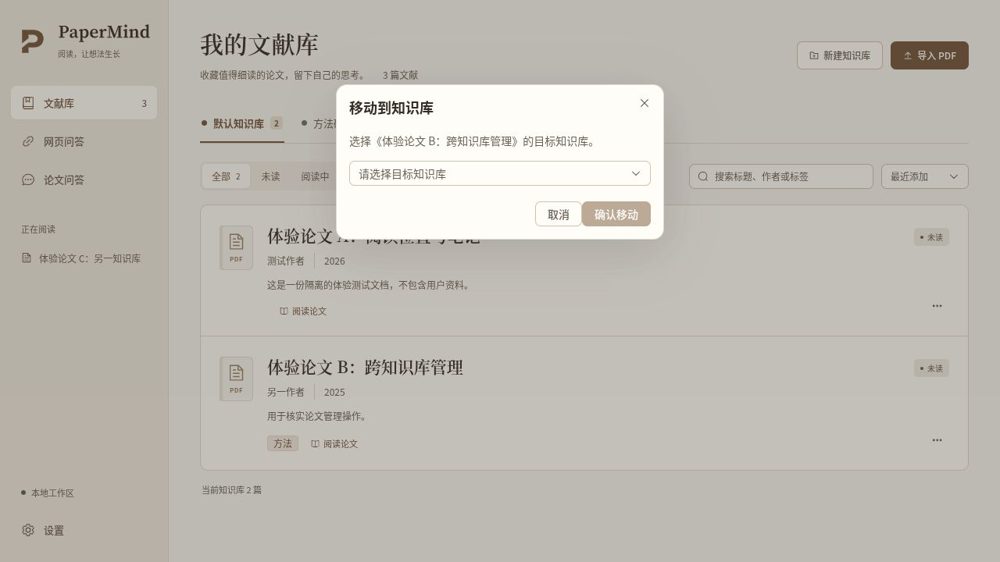
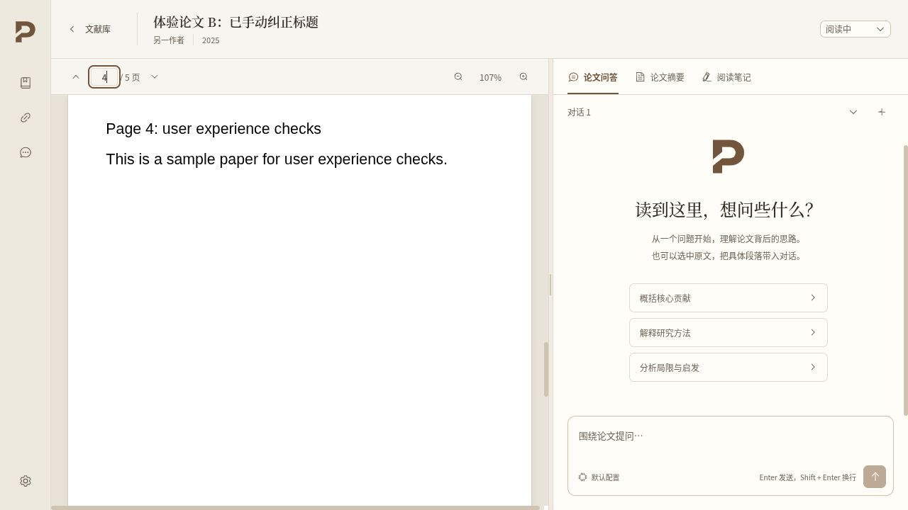
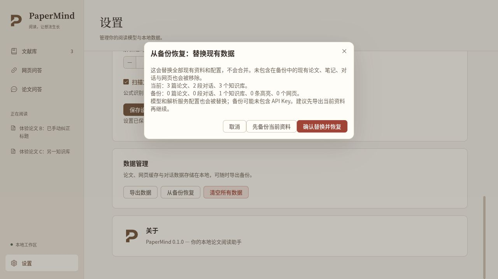

# 剩余审查项整改验证记录

日期：2026-10-20。基线：`7efa9ad03fac2980b3f4dd2df6059773954ae83a`；本记录随本轮整改代码交付。范围是体验报告剩余 7 项、4 项补充交互能力，以及工程报告剩余 7 项 F 编号问题；不等同于所有长期架构风险、模型质量与性能均已消失。

## 自动验证

| 检查 | 结果 |
| --- | --- |
| `npm test` | 152 个测试文件、1979 项 Vitest 测试通过；19 项脚本测试通过；无未处理测试异常。较上一版本增加 98 项 Vitest 回归。 |
| `npm run typecheck` | 严格 Vue／TypeScript 检查通过。 |
| `npm run build -- --publish never` | 图标检查、类型检查、前端与 Electron 构建、Linux AppImage 打包成功；明确不发布。产物位于忽略目录 `release/`，不纳入提交。 |
| `npm run bench:product -- --smoke` | 成功：真实共享 PDF.js／E-k5／RAG／Docling 摘要算法，输入为合成 PDF、假向量与固定模型输出，结果标记 synthetic。 |
| 产品评测真实入口契约 | 临时 PDF＋localhost HTTP fixture 经过真实 PDF 提取、Docling 转换与 LLM 请求；无外部收费服务或 SSH。 |
| 发布文件名 | 在临时目录执行工作流原始 Bash 重命名步骤，Linux／macOS／Windows 名称均有正确应用名前缀及版本。 |
| 独立代码审查 | 全产品差异、所有新增模块、benchmark 和窗口生命周期配套均通过；发现的模型选择并发回滚问题已用真实组件／延迟 IPC 回归修复并复审。 |

先观察失败再实现的回归覆盖：多项独立撤销、跨路由工作现场、移动目标选择、元数据编辑、三 provider 异常结束、摘要占位与重试／取消、滚动控制、跨库已选材料、快捷键、阅读恢复、跨页来源、loadingTask 清理、恢复前确认与设置离页保护。新增 beforeunload 保护另覆盖“用户取消关窗后仍保留网页预览授权”，实际窗口销毁后再释放子视图和缓存。

构建打印了现有 package description／author／Linux category 未配置等提示；不影响本次构建成功。Node 测试环境有 localStorage 实验提示；坏存储与不可用存储路径已有容错测试。未借此降低验证或修改依赖版本要求。

## 隔离浏览器验收

使用实际 Vue App／路由／组件、真实五页测试 PDF，替换 Electron IPC 为构造的内存资料。未操作用户数据库、原文或凭据，也未向真实模型提问。验证了：

1. 论文菜单可进入编辑，修改标题与标签保存后列表立即更新，标签可被搜索。
2. “移动到知识库”先选目标，未选择时确认按钮禁用；取消不写入。
3. 阅读器输入第 4 页并 Enter 后实际显示该页；返回再打开同一论文仍恢复第 4 页；列表保留搜索条件。
4. 设置显示自动保存和显式保存方式；修改 Docling 后离页出现“继续编辑／放弃修改并离开”。
5. 选择备份只打开替换预览，显示当前／备份数量及替换范围，并提供取消、先备份和明确确认；取消保留资料。

## 使用与边界

- 正常开发入口仍为 `npm run dev`，会启动 Vite 和 Electron。该服务在完成 GitHub 交付并同步 `main` 后启动；实际地址、运行状态见本次交付回复。
- 原生 Electron 全部功能的逐项人工验收、Windows／macOS 安装器运行和长期 PDF 资源压力测试未包含在上述浏览器验收中。
- 真实模型与远端 Docling 的质量基准未运行。新入口支持预置本地权重与显式服务配置；不自动下载模型、不默认建 SSH，且明确拒绝尚未等价支持的 Anthropic／推理模型协议。详见 [产品 benchmark](../../bench/README.md)。
- 聊天摘要与摘要面板分别拥有模型任务；两者主动同时生成同篇时可能各发一次请求。共享 Docling 准备任务不因一个消费者取消而被假称终止；取消阻止本会话的后续模型与落库动作，已派发 IPC 不可撤销。
- 旧摘要正文不静默改写；重新生成后应用修正的来源映射。没有 charspan 的旧解析缓存会降级为真实页范围。
- 文献筛选、聊天草稿、导入队列和删除等待任务为会话状态；阅读位置使用本地存储。关闭应用时未提交删除仍保留原记录。移动暂不提供撤销；目标选择、取消、持久化失败重试已完成。
