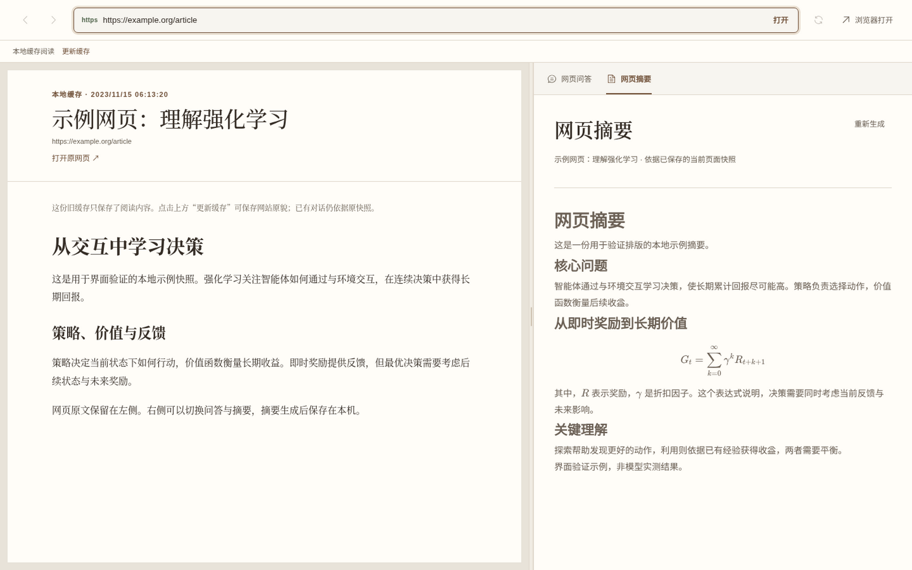

# 网页摘要采集：通用逻辑排查与验证

2026-10-21，沿用 `feat/multimodal-summary-mvp`。本轮修复针对页面结构和浏览器生命周期，没有按域名、文章标题或图片文件名分支。

## 共性缺陷与修复

1. **加载等待顺序错误。** 原先先等待 `loadURL`，再启动 idle 超时；次要资源挂起时，前一个等待已经无法结束。现在主文档 DOM-ready 或加载结束即可进入采集准备，主文档本身有 20 秒等待上限。
2. **资源就绪与内容完整混为一谈。** 原检查只覆盖 document.images；原生 lazy、观察器声明的 data-src/data-srcset、CSS 背景、SVG 外部图像、Shadow DOM 中的图像没有统一准备。现在原生 lazy 和原网页声明的图片地址进入准备，检查开放 Shadow DOM、背景和外部 SVG 图像；等待资源有预算，超时停止未完成加载，在模型读取的视觉副本中写明缺失，不把它们伪装成已提取原图。正文和公式尚未就绪不以缺图策略跳过。
3. **滚动条不是正文裁切。** 原先根节点、导航区、图标与阅读容器共用 overflow 判定。现在根滚动由 Chromium 分页，正文内部滚动走原貌展开；导航、装饰和小图标不再驱动整个页面的展开。
4. **动态页面容易混用版本。** 原先 HTML、PDF 和 MHTML 在脚本仍运行时分别读取。现在准备后短暂禁止页面脚本执行，在同一检查点序列化和保存，再做严格 DOM 与导航代次校验；成功或失败均恢复脚本、媒体模式、滚动位置和 loading 属性。准备阶段已载入的原网页图片继续保留。普通计时器和小幅计数变化不会直接被误判成正文虚拟化。
5. **离线无法补回不存在的内容。** 原先没有识别移除旧正文的虚拟列表、持续追加内容的无限列表、嵌入正文框架等范围边界。现在对可检测的这些情况明确失败，要求独立文章、章节或导出文件，而不是报告整页完整。离线快照中仍需脚本才能渲染的正文/公式立即提示更新快照，不等待一个不可能完成的离线渲染。
6. **失败后的晚到操作。** 采集检查在异步边界重新验证时限和源页面；超时后不继续归档和发布旧来源提示。采集时的临时状态在 finally 恢复，原貌采集成功后清除旧失败提示。

## 页面范围契约

支持对象是可确定范围的已加载网页文档，不是链接指向的整站或无限信息流。资源缺失允许带限制的摘要；正文范围无法确认时明确提示。保存好视觉快照后的素材定位与摘要继续由应用级任务执行，切换功能不中断这些模型任务。

若普通渲染窗口已隐藏而页面仍需滚动触发内容，采集不会声称已完成懒加载：提示回到网页完成保存。已保存快照的后台摘要不受此限制。开放 Shadow DOM 的可见内容经过实测；不宣称已覆盖所有封闭 Web Component、任意虚拟化实现或全部第三方嵌入系统。

旧快照只能恢复当时已保存的资源，不能从旧缓存凭空补回从未载入的正文。新规则不会删除历史摘要；需要新版本原文时使用更新缓存。

## 可重复验证

自动回归：

```sh
npm test
npm run typecheck
```

真实 Chromium 结构矩阵，无公网请求和模型费用：

```sh
./node_modules/.bin/electron scripts/web-summary-capture-smoke.cjs
```

Linux 需要图形会话或 Xvfb，以及 Poppler 的 `pdftotext`。脚本编译并压缩当前产品代码（同时验证浏览器端序列化函数在压缩后可执行），在临时 profile 和文件中运行，打印结果并保留 `results.json` 和 PDF，路径在末尾输出。不读写用户数据库。

矩阵共 16 项：静态长文、ARIA-busy 延迟正文、原生懒加载、观察器声明图片、内部滚动原貌恢复、持续更新计时器、延迟公式、Canvas、开放 Shadow DOM、缺失图片/字体、嵌入框架边界、隐藏滚动窗口边界、虚拟列表边界、无限追加边界，以及实际 PreviewController 的持续变化 DOM 与挂起资源场景。检查正文末尾标记、实际图片加载、资源限制说明、源版本一致、脚本恢复和明确边界；不以“产出了 PDF 文件”代替完整性检查。矩阵的渲染结构案例使用 offscreen Chromium 保持渲染帧，另有普通隐藏窗口的拒绝案例。

主文档已就绪但图片请求永久不结束的 PreviewController 案例，约 10–13 秒产生带明确缺失说明的视觉副本，没有一直等待 loadURL 或丢掉整篇正文。

## 不同实际站点

同一份产品采集代码，临时 offscreen Chromium，逐个加载原 URL；不设置站点规则，不预先裁掉页面。以下耗时不包含模型调用。

| 页面 | 视觉副本 | 加载 | 采集 | 正文提取字符数 | 资源限制说明 |
| --- | --- | --- | --- | --- | --- |
| niutrans RL-without-Tears reader | 58 页，3,566,306 字节 | 3.98 秒 | 6.66 秒 | 97,773 | 无 |
| MDN JavaScript Guide / Introduction | 8 页，995,520 字节 | 1.49 秒 | 2.56 秒 | 11,345 | 无 |
| Lil’Log Harness Engineering for Self-Improvement | 26 页，3,383,361 字节 | 24.29 秒 | 3.25 秒 | 45,292 | 无 |

表中的加载时间是测试窗口等待完整 loadURL 的时间，包含次要资源；产品入口另以主文档 DOM-ready 作为进入准备的条件。实际站点测试用于检验不同页面结构；结果不是所有网页的完备证明。Lil’Log 此次重新在线加载资源齐全，与旧 MHTML 中缺少 aflow.png 的状态不同，不能用新状态反推旧缓存没有缺图。

统一摘要模型流程的完整实测仍见 `multimodal-summary-mvp.md`：使用真实 deepseek-flash 从整份网页快照准备素材、裁剪并生成图文与公式摘要。本轮不为每个结构 fixture 重复付费调用模型，而是重点验证共享模型上游的页面证据可靠性。

最终自动检查：160 个文件、2,045 项 Vitest 测试及 19 项脚本测试通过；npm run typecheck、npx vite build 和 git diff --check 通过。构建覆盖前端、Electron 主进程和 preload，未生成安装包。

交付审查补充：论文摘要的取消信号覆盖缓存读取、模型启动和最终保存；缓存尚未返回时停止不会再启动新模型任务。旧长摘要首次进入新视觉缓存续写时保留完整原文，而非仅保留末尾 9,000 字符。已加入两项回归测试并通过独立复审。

## 网页页签界面

下图使用当前产品组件和本地示例快照验证布局及公式显示；示例摘要不是模型实测结果，不包含用户文档或数据库。


